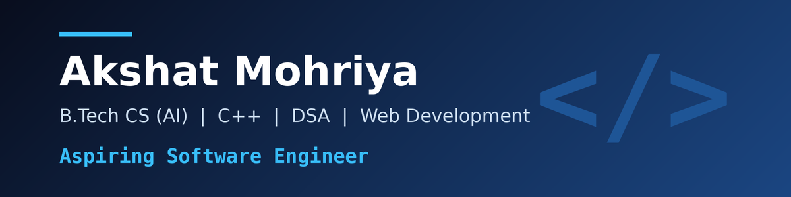
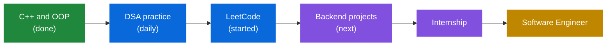
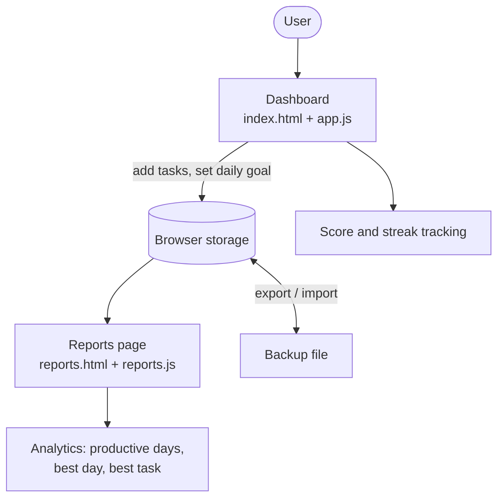

<h3>B.Tech CS (AI) student at JEC Kukas, Jaipur &nbsp;|&nbsp; Building towards a software engineering career</h3>

  
  
  
  
  
  

  
  
  
  

---

## About Me

I'm a second-year **B.Tech CS (AI)** student at **JEC Kukas, Jaipur**. I enjoy solving DSA problems in **C++**, building web projects, and turning ideas into working software. My goal is a **software engineering** career, and I'm putting in the work step by step: practising DSA, building real projects, and learning in public here on GitHub.

---

## My Roadmap

---

## Featured Projects

| Project | What it does | Tech |
|---|---|---|
| [**Task Command Center**](https://github.com/gpro89465-afk/Task-tracker) ([live demo](https://gpro89465-afk.github.io/Task-tracker/)) | Productivity tracker with task categories, priorities, estimated hours, daily goals, streaks and a reports page with analytics | HTML, CSS, JavaScript |
| [**DSA Solutions**](https://github.com/gpro89465-afk/DSA-solutions) | My C++ solutions to DSA problems, organised by topic, with approach and complexity noted in every file | C++ |

### How Task Command Center works

**Next upgrade:** adding a real backend with a database and user accounts.

---

## Tech Stack

| Area | Skills |
|---|---|
| **Programming** | C, C++, Object-Oriented Programming, Data Structures and Algorithms |
| **Web** | HTML, CSS, JavaScript, backend and website development |
| **AI** | Prompt engineering, generative AI, LLM and RAG concepts |
| **Tools** | Git, GitHub, VS Code |
| **Currently learning** | Data analysis fundamentals (Google Skills) |

---

## Achievements and Certifications

- **Smart India Hackathon 2026:** built the backend and website for the heat shield problem statement and cleared the college-level round
- **Academics:** 9.51 SGPA (Semester 1), 8.70 SGPA (Semester 2), 95% in Class XII
- **Anthropic:** AI Fluency: Framework and Foundations; Claude 101
- **Google Cloud:** Introduction to Generative AI; Introduction to Large Language Models; Applying AI Principles; Prompt Design in Vertex AI (Skill Badge)
- **EY and Microsoft:** AI Skills Passport
- **Scaler:** Designing Scalable RAG Pipelines (masterclass)
- **GRRAS Solutions:** Agentic AI workshop

---

## Currently Working On

- Solving DSA problems in C++ and publishing them in [DSA Solutions](https://github.com/gpro89465-afk/DSA-solutions)
- Practising on LeetCode
- Upgrading Task Command Center with a backend and database
- Learning data analysis through Google Skills

---

## Goals for 2027

- [ ] Solve 100+ DSA problems
- [ ] Build a full-stack project with a backend and database
- [ ] Land a software engineering internship
- [ ] Take part in more hackathons and coding contests

---

## Let's Connect

  

<i>Learning in public, one commit at a time.</i>

